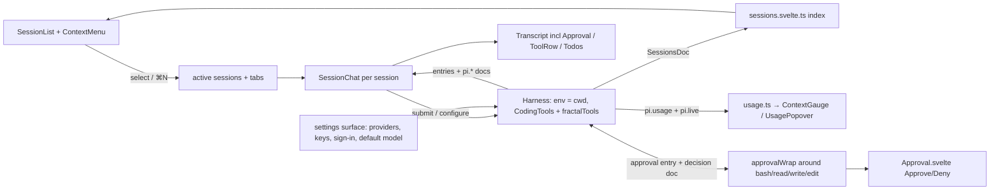

# TECH.md — the agent workbench

Implementation plan for the finalized `PRODUCT.md` (sessions and projects, composer, model and
thinking selection, usage, run progress, tool use and approvals, provider configuration,
transcript, shell and Settings surface).

**Status: not implemented.** This describes a plan; nothing in it has landed. Every runtime fact
below was read from the installed packages, the shipped native binary's interface, and this app's
source — not from documentation.

Code references are pinned to the working tree at commit `59f8ee1` (last commit; the working tree
has uncommitted changes, so re-grep before editing).

## Context

### What exists today (the gap)

- **Chat facade.** [`src/surfaces/agents/session.svelte.ts`](src/surfaces/agents/session.svelte.ts)
  defines `AgentChat` (`:35-49`: rows/busy/error/usageText/modelOptions), `ensure()`
  (`:79-98`: `harness.root()` or one `createConversation` for the panel chat), `reconcile()`
  (`:133-142`, the staleness fix that compares the stored agent against settings on every send),
  `reconfigure()` `:144-155`, `send()` `:165-198`, `stop()` `:200-210`, `reset()` `:212-220`, and
  exactly two module singletons `chat`/`chat2` (`:223-224`). One shared `persisted('pi')` slot
  holds provider+model (`:13-16`).
- **Harness.** [`src/kernel/pi/harness.svelte.ts:23-36`](src/kernel/pi/harness.svelte.ts#L23-L36):
  `Harness.open(storage, { models, registry: createRegistry() })` over SQLite at
  `<data_dir>/pi/agent.sqlite`. **No `env`**, **no extension installed**, **no
  `conversationCreated` hook** — so the agent has no filesystem/shell and no tools at all.
- **Providers.** [`src/kernel/pi/models.ts`](src/kernel/pi/models.ts): five hand-written
  `PROVIDERS` (`:18-24`), `DEFAULT_MODEL` (`:26-32`), plaintext `persisted('pi-keys')` (`:38-44`),
  `injectStoredKeys()` pushing keys into `process.env` (`:47-53`), `buildModels()` registering
  those five on `createModels()` (`:84-96`), `keyStatus()` reading env+slot (`:98-105`).
- **Projection.** [`src/kernel/pi/project.ts`](src/kernel/pi/project.ts): `projectEntries()`
  (`:33-77`) entries+partial → rows; `isBusy()` `:80-82`; `formatUsage()` `:85-96` (models bucket
  only).
- **UI.** [`Sidebar.svelte:17-97`](src/surfaces/agents/Sidebar.svelte#L17-L97) (provider
  segmented, model `Button` list, key editor, spend, reset), [`Composer.svelte:16-40`](src/surfaces/agents/Composer.svelte#L16-L40)
  (textarea + model `Pill` + Send/Stop + one error line), [`Transcript.svelte:10-38`](src/surfaces/agents/Transcript.svelte#L10-L38),
  manifest [`index.ts:10-23`](src/surfaces/agents/index.ts#L10-L23). `SURFACES = [home, tools,
  agents]` at [`src/surfaces/index.ts:12`](src/surfaces/index.ts#L12); app commands at
  [`src/kernel/surfaces.svelte.ts:52-63`](src/kernel/surfaces.svelte.ts#L52-L63); tabs/toolbar
  contract at [`src/kernel/types.ts:47-56`](src/kernel/types.ts#L47-L56).

### What the runtimes give us (verified)

**pi-durable 1.0.2** (`node_modules/@earendil-works/pi-durable/dist/…`)

- `Storage.scanConversations(query, limit, cursor, ctx)` (`types.d.ts:797`) — enumeration.
- `ConversationRecord` is `{ id, parent?, owner? }` only (`types.d.ts:246-258`): no title, no
  timestamps, no labels. All §1 metadata must be our own records.
- `defineDoc`/`defineDocFamily` (`documents.d.ts`), `Session.watchDoc(token, ctx)`
  (`types.d.ts:747`), `Tx.doc(token, key, seed)` (`types.d.ts:709-714`) — a live, durable,
  subscribing index document.
- `HarnessOptions`: `env(target: EnvTarget{conversationId, cwd, read}) → ExecutionEnv`
  (`harness/types.d.ts:356-362`), `conversationCreated(tx, conversation)` (`:374`) — runs in every
  commit that creates or forks a conversation; a throw fails that commit, table reads inside it
  throw `ReadAfterWrite`. `AgentState` (`:237-253`): `model`, `thinkingLevel` (incl. `"off"`),
  `extensions` (names), `tools` (filter), `instructions`, `cwd`. `Conversation.configure/entries
  (newest-first, `:453`)/fork(at, …, `:454`)/reset/abort/compact/context/viewState`.
- `Extension { name, tools, sections, hooks, wraps, tasks }` (`harness/types.d.ts:194-204`);
  `registry.install/uninstall` (`:230-234`); `defineTool`, `wrapTool(tool, wrapper)`, `section`,
  `hook` (`harness/define.d.ts`); `defineEntry<D>(kind)` (`entries.d.ts:6`); `ToolExecutionApi
  extends DocumentObserver, DocumentReader` (`harness/types.d.ts:113`) — a wrapped tool can read
  **and watch** documents while it runs, which is what makes a blocking approval possible.
- `CodingTools` extension (`tools/index.d.ts`): ready-made `bash` (streams via `api.output()`,
  spills beyond limits), `read`, `write`, `edit`; each resolves its environment per call through
  `requireEnv(api)` (`tools/env.d.ts`) = `HarnessOptions.env`. `ToolSlot {callId, name, status,
  output, droppedBytes, droppedLines, diagnostics, entry}` (`harness/live.d.ts`) is the live round.
- `UsageDoc/UsageState` (`harness/usage.d.ts`), `LiveDoc/LiveState{run,generation,tools,compactions}`,
  `Harness.usage(ctx)`, `Harness.taskGraph(ctx)`/`TaskGraph` (`harness/task-graph.d.ts`).
- SQLite schema, read from the live `agent.sqlite`: `conversations`, `entries`, `tasks`,
  `submissions`, `documents` (`scope_kind`/`owner_id`), `document_revisions` (by `document_id`),
  `record_ids`, `durable_metadata`, `durable_schema`. Today the store holds **one** conversation
  (`id 1`, the root).

**pi-ai 1.0.2** (`node_modules/@earendil-works/pi-ai/dist/…`)

- `builtinModels(options?: CreateModelsOptions)` / `getBuiltinProviders()` (`providers/all.d.ts`)
  — the whole catalog.
- `createProvider({id, name, baseUrl, auth, models, fetchModels, api})` (`models.d.ts:206-256`)
  and `Models.setProvider` — custom endpoints with a live fetched list.
- `Models.getProviders/getModels/getModel/refresh/checkAuth(→{source,type})/getAuth/login/logout`
  (`models.d.ts:130-193`).
- `ProviderAuth { apiKey?; oauth? }` (`auth/types.d.ts:236-239`); `OAuthAuth { name, isSubscription?,
  loginLabel?, login(interaction), refresh, toAuth }` (`:211`); `Models.login(providerId, type,
  interaction)`. The interaction surface is fully specified: `AuthPrompt` = text | secret | select |
  manual_code (`:105-127`), `AuthEvent` = info | **auth_url** | **device_code** (userCode +
  verificationUri + interval) | progress (`:132-149`), `Credential = ApiKeyCredential |
  OAuthCredential` stored through `CredentialStore {read, list, modify, delete}`
  (`auth/credential-store.d.ts`). So §7.6's sign-in flow is buildable for real.
- `KnownApi` (`types.d.ts:15`): `openai-completions`, `openai-responses`, `azure-openai-responses`,
  `anthropic-messages`, `google-generative-ai`, `mistral-conversations`, and more — the API-format
  dropdown's option list.
- `Model { contextWindow, maxTokens, input: ("text"|"image")[], reasoning, thinkingLevelMap,
  cost: {perMillion…} }` (`types.d.ts:906-938`); `ThinkingLevel = minimal|low|medium|high|xhigh|max`
  and `ModelThinkingLevel = "off" | ThinkingLevel` (`:24-25`); `Usage { input, output, cacheRead,
  cacheWrite, reasoning?, totalTokens, cost }` (`:291-306`); `estimateContextTokens(messages) →
  {tokens, usageTokens, trailingTokens}` (`utils/estimate.d.ts:3-16`).

**gpuix-svelte 0.1.0 + @gpuix/native** (`node_modules/gpuix-svelte/src`, `node_modules/@gpuix/native`)

- The event bridge maps a Svelte prop to a GPUI event via `GPUI_EVENTS`
  (`gpuix-svelte/src/events.ts:6-32`) and drops anything else: `addEventListener` returns early
  when `to_gpui_event(type)` is null (`renderer.ts:545-548`). **Probe result (2026-10-05, headless,
  `click(node, { button: 2 })`): a right-click arrives as `auxclick` with `isRightClick: true`
  (and `mousedown` with `button: 2`); `oncontextmenu` stays silent because `contextMenu` is not in
  `GPUI_EVENTS`. So context menus bind `onauxclick` gated on `e.isRightClick === true` — **no
  dependency patch needed**, and the `contextMenu` wiring is unnecessary.
  (`gpuix-svelte/src/test.ts:160-182` for the `button` support.)
- No folder picker, no dialog API: `GpuixRenderer` exposes only window title/activate/blur/focus
  (`gpuix-svelte/src/types.ts:107`), and the native crate ships only as a compiled binary
  (`@gpuix/native-darwin-arm64/gpuix-native.darwin-arm64.node`; upstream `github.com/remorses/gpuix`).
  So PRODUCT's Prerequisite 2 is native-side work (§0 below).
- Overlays: `position: absolute` + `inset` supported (`src/style.ts:60-71`), `Portal.svelte`
  mounts under a `position: relative` root covering the window (`renderer.ts:665`),
  `getElementBounds(id)` gives painted bounds (`components/Scroller.svelte:62-70`) — anchored
  panels are feasible; `Scroller virtual` gives `<virtual-list>` rows for long lists.
- The tag set (`renderer.ts:29-42`): `div/ text/ img/ svg/ canvas/ input/ textarea/ anchored/
  code/ diff/ markdown/ virtual-list`; anything else degrades to `div`. `<svg src>` paints an
  asset file only — no inline shapes, and the `canvas` tag has **no JS painting API** exposed, so
  a drawn arc gauge (§4.1) also needs a native-side addition (§0), exactly as PRODUCT prereqs it.
- Drag pattern to reuse for drag-to-move (§1.16): `Splitter.svelte:29-60` — a press sets state,
  GPUI keeps sending `mousemove` with `pressedButton` wherever the pointer goes, release detected
  by `pressedButton !== 0`. Rows additionally get `mouseEnter` to show the drop target.
- Keyboard focus: `autofocus`/`tabIndex` are universal props; `on_window_key` handles Esc at the
  window level (`renderer.ts:642`), which is how every overlay closes.

## Proposed changes

Sliced in dependency order; each slice leaves the app working.

### 0. Host prerequisites (PRODUCT's §Prerequisites)

1. **Context menus — resolved, no patch.** The probe proved right-clicks arrive as `auxclick`
   with `isRightClick: true`, so the primitive is `ui/ContextMenu.svelte`: an anchored `Menu`
   opened by `onauxclick` gated on `e.isRightClick === true`, used by every §1 row and §7 row.
   The probe itself becomes a permanent headless assertion (left click must NOT open it).
2. **Folder picker — done in-app, native proposed.** Upstream proposal is
   filed (`remorses/gpuix#82`: a `pickFolder()` renderer call posting to
   JS; `@gpuix/native` API + binary rebuild). Until it lands, picking is
   an in-app dialog: `src/kernel/folders.ts` (pure dir
   list/navigate/validate, bun-tested) behind `ui/FolderPicker.svelte`
   (breadcrumbs, capped subfolder list, typed-path jump, Choose/Cancel —
   same `initial`/`onchoose`/`onclose` props the native call will take),
   opened from the history **Browse** button and the composer's **Choose
   folder**. The typed-path rows stay as the no-browse fallback. When the
   native call exists, only the dialog's backend changes.
3. **Arc gauge (PRODUCT §4.1 "arc svg or canvas/shape API has to be built").** Same decision as
   §0.2: native-side addition, filed upstream; UI falls back to icon+number through one
   `ContextGauge.svelte` indirection until it exists.

### 1. Session index and projects (`src/kernel/pi/sessions.svelte.ts`, `metadata.ts`)

`ConversationRecord` carries no metadata, so the app owns it:

```ts
// metadata.ts — one session-scoped singleton document, watched live
export const SessionsDoc = defineDoc({
  kind: 'fractal.sessions', version: 1, scope: 'session',
  initial: () => ({ sessions: {} as Record<string, SessionMeta>, projects: {} as Record<string, ProjectMeta> })
});
export type SessionMeta = {
  title: string; projectId: string | null;            // §1.15 (fixed at creation), §1.16 (move)
  createdAt: number; updatedAt: number;               // ours; entries themselves carry none
  pinned: boolean; archived: boolean;
  thinkingLevel?: ModelThinkingLevel;                 // §3.6 (mirrors AgentState)
  agentType: 'plan' | 'build' | 'ask';                // §2.3
  access: 'supervised' | 'edits' | 'full';            // §2.4
  draft: string;                                       // §2.7 (draft lives with the session, app file)
};
export type ProjectMeta = { path: string; name: string; pinned: boolean; archived: boolean };
```

- One singleton (not a per-conversation family) so the history sidebar is one `watchDoc`
  subscription: renames, pins, moves, the live dot and order are one live value.
- `openHarness()` installs a `conversationCreated` hook (`harness/types.d.ts:374`) seeding the
  index entry for every creation path (root, `createConversation`, fork, raw `tx.createConversation`).
  The hook writes only the index document; any failure is reported and the storage scan backfills
  later (a throw inside the hook fails the creating commit — do not throw).
- Enumeration: `scanConversations` over the storage handle `openHarness` already holds, reconciled
  with the doc at open; a conversation missing an index entry (upgrade from today's store) gets a
  backfilled one.
- **Titles (§1.18, deterministic):** the first user message with **≥ 5 words or ≥ 30 characters**
  becomes the title; shorter probes ("hi", "are you there?") are skipped and the scan continues;
  if no message qualifies, the title stays `New session`. Renaming wins over derivation. Unit
  test pins the rule.
- **Time buckets (§1.4):** Today/Yesterday/Previous 14 days/Older classified from `updatedAt` at a
  pinned clock; backfilled entries with unknown `createdAt` land in **Older**.
- Operations: `create(projectId?)`, `select`, `rename`, `pin/unpin`, `archive/unarchive`,
  `moveSession(id, projectId|null)` (§1.16), `moveProjectOrder` (pinned-first, then recent),
  `fork(sessionId, atEntryId)` (→ `Conversation.fork`), `remove(sessionId)`.
- **`remove`** is the one place below the public API: one SQLite transaction deleting
  `document_revisions` → `documents` (`scope_kind='conversation' AND owner_id=:id`) → `entries` →
  `tasks` → `submissions` → the `conversations` row; `record_ids` and `durable_metadata` untouched
  (IDs are never reused, the sequence never goes backwards). Schema-checked, fails closed (leaves
  everything, reports) if the schema does not match.

### 2. Chat registry, multi-active sessions and tabs (`session.svelte.ts`)

Replace the two singletons:

```ts
class SessionChat {                       // one per conversation the app has touched
  rows, busy, error, usage, gauge, todos
  conv: Conversation | null; view: AttachedReplicatedState<ConversationView> | null
  send / stop / reset
  configure(model? | thinkingLevel? | cwd? | agentType? | access?)
}
export const chats = new Map<string, SessionChat>();
export const active = $state({
  surface: [] as string[],                // §1.5: multiple active; surface tabs — newest active first
  panel: null as string | null            // panel hosts one
});
```

- `viewState()` subscriptions are per *open* session (active surface sessions + the panel's);
  SessionList needs no per-row subscription — it reads `SessionsDoc`.
- The Agents surface's `tabs` (`kernel/types.ts:52`) lists its active sessions; selecting a
  tab = selecting a session. `⌘N` / §1.17 creates a session in the current project and opens a new
  tab. The sidebar-panel keeps exactly one session (§9.7); both regions may run
  concurrently (§1.21) — they already do, since each `Conversation` submits independently.
- `ensure()/reconcile()/reconfigure()` semantics carry over unchanged: compare stored agent against
  the intended one on every send (`session.svelte.ts:133-142` stays the reference behavior).
- The `pi` settings slot becomes the **default for new sessions** (§7.2); a session's own model
  lives in `SessionMeta` and is applied with `configure({model})`.

### 3. Per-session agent state: workspace, thinking level, type, access

- `Conversation.configure({ cwd, thinkingLevel })` (`AgentState`, `harness/types.d.ts:237-253`)
  — **workspace** (§2.5) is the session's project path set at creation (§1.15) or wherever the
  session was moved (§1.16, then `configure({cwd})`); **thinking level** (§3) is
  `configure({thinkingLevel})`, and `Model.thinkingLevelMap` (`null` marks unsupported) drives
  §3.5's dimmed rows and the "lowest supported level ≥ chosen" fallback with an inline notice.
- `agentType` (§2.3) and `access` (§2.4) are ours (`SessionMeta`): both are read by the approval
  wrapper from `SessionsDoc` on every call. Plan/Ask refuse mutating tools outright (the model is
  told to describe the work instead) rather than filtering the offered tool list — simpler, and
  the refusal is visible in the transcript. Access → ask/allow per the policy table (§4).
  Defaults: `build` / `supervised` (Supervised never silently becomes Full access).
- `openHarness()` gains the environment:

  ```ts
  env: (target) => new NodeExecutionEnv({ cwd: target.cwd ?? data_dir(), shellEnv: process.env })
  ```

  A workspace-less session gets an env whose cwd is unusable — §6.9 refusals are enforced in our
  policy layer, not by trusting the env.
- Branch and worktree count (§2.5/§1.20): `git -C <projectPath> rev-parse --abbrev-ref HEAD` and
  `git worktree list --porcelain`, read on selection, cached, off the render path.

### 4. Tools and approvals (`src/kernel/pi/tools.ts`)

At `openHarness()`:

```ts
registry.install(CodingTools);        // bash, read, write, edit — pi-durable ships them
registry.install(fractalTools);       // ours: policy wraps, instructions, todo tool
```

- **Policy wraps** (`wrapTool(bashTool, approvalWrap)` etc.) classify each call: reads never ask
  (§6.1); `write`/`edit` ask unless access ∈ {edits, full}; `bash` asks unless access = full.
  When a call must ask the wrapper: appends an approval entry (`defineEntry('fractal.approval')`,
  `data = { callId, tool, summary, args }`), creates a decision document for that callId, then
  waits on it via `api.watchDoc` (a tool may observe documents) while also polling
  `pi.live` to detect a stopped run. Approved → proceed; denied or stopped → return an error
  result carrying the denial, so the model sees it and the run continues (§6.3-§6.4). Both plans
  and per-call confinement (a path resolving outside the workspace, or any call with no
  workspace) refuse with the reason (§6.9).
- **Approve/Deny UI** (`Approval.svelte`): snapshots pending decisions for the open session,
  renders §6.2's row, writes the decision through `h.commit`.
- **Approval/todo watches in the UI** (`AgentChat.ensureAppWatches`): the
  view mounts built-in docs only, so the app's own conversation docs ride
  on separate `watchDoc` watches, which are non-creating (missing doc →
  `undefined`, never throws). Establishment retries on open/send/render
  but **at most one attempt per 2s, and an attempt never chains into the
  next one** — respawning from completion is a tight self-feeding loop
  (F22: saturates the session queue, starves timers). A single unref'd
  timer re-arms retries across quiet periods (a run paused on approval
  commits nothing, so nothing re-renders); `decide()` retries
  immediately so the row flips on answer.
- **Step list §5:** a `todo` tool (`defineTool`) whose state is a `fractal.todo` conversation doc
  that the transcript-adjacent `Todos.svelte` renders; kept up to date while the run works (§5.3),
  stays visible until the next send (§5.4). Durable-runtime task graph stays readable via
  `Harness.taskGraph()` for later.
- `pi.usage.tools` (per tool name, `UsageState`) plus `ToolSlot.status/output/diagnostics`
  feed §6.6-§6.7 (`ToolRow.svelte`: name, one-line input summary, streaming output while running,
  result or failure with error text, expandable truncation it states).
- Transcript rows for approvals/notifications ride on typed entries
  (`entries.d.ts:6`, `Tx.appendEntry(token, …)`, `types.d.ts:687-689`).


### 5. Providers, credential store, sign-in, custom endpoints (`src/kernel/pi/models.ts`)

 - `buildModels()` → `builtinModels({ credentials })` over the app's `CredentialStore`
   (done Slice 5: `createCredentialStore` from `providers.ts` bound to a
   `persisted('pi-credentials')` slot; no separate `SettingsCredentialStore` class and no
   `modelsStore` — remote-catalog persistence is unneeded while custom endpoints carry
   static model lists). `PROVIDERS`/`DEFAULT_MODEL` stay as thin shims for the current
   sidebar/session call sites and are deleted with Slice 7's Settings surface.
 - The store persists into the `pi-credentials` slot (entries array — `persisted`'s merge
   drops free-form map keys, so the bag maps over an array). `injectStoredKeys()` is kept
   (now store-backed) — `keySource()` provides the per-provider source label
   ("ANTHROPIC_API_KEY" vs "stored in this app") that §7.12 needs.
- **Enable switches (§7.4):** `persisted('pi-providers', { enabled: {}, custom: [] })`. Disabled =
  filtered out of the panels only; never `deleteProvider` for a shipped provider.
- **§7.6 modal:** `Sign in with a subscription` vs `Connect with an API key` membership is derived
  per provider from `provider.auth` (`apiKey?` → keys; `oauth?` → subscriptions; both → both), not
  a list in this app. **Sign-in is in scope:** drive `oauth.loginLabel` through `Models.login`
  with the UI as the `AuthInteraction`: `AuthPrompt` (text|secret|select|manual_code, `:105-127`)
  rendered into a small modal form; `AuthEvent.info/progress` shown as status lines;
  `AuthEvent.auth_url` → open externally (`open` via `spawnSync`, the `pbcopy` pattern in
  `src/kernel/clipboard.ts:24`); `AuthEvent.device_code` → show userCode + verificationUri +
  copy, poll at the given interval until the credential lands in the store. Subscription rows the
  runtime marks `isSubscription` are the ones that start flows (§7.6 last line).
- **Custom endpoints (§7.8):** `createProvider` with the chosen `KnownApi` id (`types.d.ts:15`:
  `openai-completions`, `openai-responses`, `azure-openai-responses`, `anthropic-messages`,
  `google-generative-ai`, …), `fetchModels` hitting the endpoint's model list (error verbatim on
  failure), custom model IDs as static `models`; persisted in `pi-providers.custom`, registered by
  `models.setProvider` at open + immediately on save (no restart, §7.10); edit/remove per §7.11.
- keyStatus() → sync mirror of `checkAuth` results; service rows keep §7.12's three states.
- Tests keep the faux provider path (`isTestEnv()`), unchanged.

### 6. Usage projection (§4) (`src/kernel/pi/usage.ts`, `fx.ts`)

Pure functions over the session's documents, unit-tested without a window:

- `contextFigures(view, model)` → used/total/left/percent/thisTurn from
  `estimateContextTokens(conversation messages)` (`utils/estimate.d.ts`) and `model.contextWindow`.
- `providerFigures(usageState)` → input/output/cacheRead/cacheWrite/reasoning (unreported → `—`),
  cache-hit rate `cacheRead / (cacheRead + input)`.
- `toolFigures(usageState, live)` → distinct tool names, tokens, per-tool breakdown, in-flight
  count (done Slice 6: committed per-call counts are not in these documents, so the popover's
  call count pairs this with `countToolCalls(entries)` over the committed entries).
- **Cost in INR, `fx.ts` (§4.5, fetched rate):** the catalog reports USD; the app fetches USD→INR
  from a public FX endpoint (`open.er-api.com/v6/latest/USD` → `rates.INR`), caches
  `{ rate, fetchedAt }` in a `persisted('fx')` slot, and refreshes at most daily. Offline, or
  before the first successful fetch, the last cached rate stands (and before that, a bundled
  build-time default); the popover states which rate produced the figure. The fetch is injectable,
  so tests never hit the network.
- `generationSpeed()` is the app's own measurement (submit → settle wall time ÷ committed output
  tokens); the runtime exposes no provider-side speed figure. Before a session has run, the
  popover shows the window total and `0` used, other rows absent (§4.3).

### 7. UI components

New `src/ui/` primitives (`hitbox="self"` everywhere, literal classes only in `_own.sass`):

| Component | Role |
|---|---|
| `Menu.svelte` | anchored item list (icon, label, description, check, danger); keyboard nav; Esc/outside close |
| `Popover.svelte` | `Portal` + `getElementBounds` anchoring + `position: absolute` panel |
| `Modal.svelte` | `Portal` + scrim + dialog (the `CommandPalette` pattern, `CommandPalette.svelte:14-47`) |
| `ContextMenu.svelte` | §0.1's wrapper around `Menu`, opened by `onauxclick` gated on `e.isRightClick` |
| `SearchInput.svelte` | input + search icon + clear |
| `Switch.svelte` | Settings-row toggle (existing `wb-toggle` styling) |
| `TabsList.svelte` | session tabs in the Agents surface's main-header slot (`kernel/types.ts:52`) |
| `Chip.svelte`, `ContextGauge.svelte` | composer chip; §4.1 gauge (icon+number until native arc lands, §0.3) |
| `DragRow.svelte` | §1.16 drag: press→`Splitter`'s `mousemove`+`pressedButton` pattern, `mouseEnter` highlights the drop target, drop commits the move |

Agent surface (extending `src/surfaces/agents/`): `SessionList.svelte` (+ `SessionRow` with `○`
active ring §1.5, `ProjectRow` with live dot, expandable per project §1.3, collapsed **Archived**
group §1.10), `TimeBuckets.svelte`, `MoveToMenu` (§1.16 right-click option), `ComposerModes.svelte`
(type + access), `WorkspaceRow.svelte`, `UsagePopover.svelte`, `Todos.svelte`, `Approval.svelte`,
`ToolRow.svelte`, `ModelPanel.svelte`, `ThinkingPanel.svelte`, `Approval`-aware
`Transcript.svelte` (+ session header, thinking collapse, jump-to-latest, §8).

Settings surface (new): `src/surfaces/settings/` — `Settings.svelte`, `Sidebar.svelte` (pages),
`pages/{ModelConfig,General,Shortcuts,About}.svelte`, `ProviderRow.svelte`, `AddProvider.svelte`
(with the sign-in interaction form above), `index.ts`; registered after `agents` in
[`src/surfaces/index.ts:12`](src/surfaces/index.ts#L12). Shortcuts page generated from
`all_commands()`; About shows app version, storage location + reveal action, runtime versions.

Icons to add to `src/ui/icons.ts:10-52` + `assets/icons/` (Lucide, `currentColor`): `folder`,
`folder-open`, `pin`, `archive`, `pencil`, `git-branch`, `git-fork`, `lock`, `shield-check`,
`shield-off`, `list-checks`, `rocket`, `compass`, `gauge`, `brain`, `eye`, `chevron-up`,
`more-horizontal`, `circle`, `dot`, `arrow-up`, `settings-2`, `plug`, `key`, `panel-*` as needed.

`_own.sass` and new icons land first as one shared commit; the strict style check
(`test/styles.ts`, any loss in `_own.sass` fails) stays the merge gate.

### 8. Shell and commands

- New commands ([`src/kernel/surfaces.svelte.ts:52-63`](src/kernel/surfaces.svelte.ts#L52-L63)):
  `session.new` (⌘N), `session.rename`, `session.delete`, `session.archive.toggle`,
  `model.choose`, `thinking.choose` (⇧⌘T), `settings.open` (⌘,), `settings.models`,
  `transcript.copy`, each grouped per §9.8-§9.9.
- Overlay rule (§9.11): each overlay binds `on_window_key` Esc while it is the newest one and
  closes on a scrim click that does not hit the panel (the palette's pattern).
- Dev-loop reminder: `.ts` kernel changes need a full `npm start` restart; only `.svelte`/`.sass`
  hot-reload.

## End-to-end flow



## Testing and validation

### New host prerequisite probes (run first)

| Probe | Asserts |
|---|---|
| context-menu bridge (in `agents/test.ts`) | `click(row, { button: 2 })` opens the row menu; a left click does not |
| overlay anchoring | a `Menu` opened from a row is painted within/at the anchor `getElementBounds` box, unobstructed |
| drag-and-drop | press on a session row, `mousemove` to a project row (the `Splitter` pattern), release: the session moved projects, source and target rows repainted |

### Unit suites (pure, `bun test`)

| Target | Covers |
|---|---|
| `src/kernel/pi/sessions.test.ts` | bucket classification at a fixed clock; title rule (≥5 words or ≥30 chars; "hi"/"are you there?" skipped; none → `New session`); pinned-first + recent ordering; archived excluded from buckets; index backfill; move-to-project; `remove` scoping against a copied schema |
| `src/kernel/pi/policy.test.ts` | one cell per (access × tool class × workspace-set?) → ask/allow/refuse — §6.1, §6.9; run-stopped-while-waiting → denial |
| `src/kernel/pi/usage.test.ts` | context figures against a known Usage/message list; `—` for unreported figures; cache-hit-rate math; INR formatting with the stated rate; `fx.ts` fresh-fetch / cached-rate / offline-and-bundled-default cases with an injected fetch |
| `src/kernel/pi/models.test.ts` | section membership from `provider.auth` (key-only / oauth-only / both); enabled filtering; credential store read/modify/delete; custom provider round-trip incl. fetch failure |
| `title derivation` (in sessions.test.ts) | PRODUCT §1.18 exactly, including rename-wins |

### App suites (headless, faux provider)

| File | Invariants |
|---|---|
| `src/surfaces/agents/test.ts` (extend) | §1.3-§1.9, §1.11-§1.17, §1.21 (two concurrent chats answer independently), §2.3-§2.11, §3.2-§3.7, §4.2-§4.4, §5.1-§5.5, §6.2, §6.3, §6.6, §8.1-§8.8 — approvals driven through a test extension whose tool always asks (the faux tool path; real provider not required) |
| `src/surfaces/settings/test.ts` (new) | §7.1-§7.13 incl. the sign-in modal with a scripted `AuthInteraction` (prompt + device_code events), §9.2-§9.5 |
| `test/shell.ts` (extend) | §9.1-§9.3, §9.7-§9.9 (nav gains Settings; ⌘N/⇧⌘T/⌘, wired; palette ordering unchanged) |
| `test/layout.ts` (extend) | sidebar-left min/max widths with the history content; 300-session list stays mounted and scrolls (§1.21) |
| `test/styles.ts` (unchanged, green) | §9.10 — no class lost on the way to GPUI |

Timestamps and speed figures are injected, never slept on. `npm test` + `npm run typecheck` green
after every slice.

### Manual verification (real provider)

1. Right-click a session row → the reference menu opens; left-click never opens it.
2. Restart: sessions, titles, projects, pins, archived, thinking levels, drafts survive.
3. A session on a real repo: read a file under any mode; `write` under Supervised (approve), then
   Auto-accept (no prompt), then Full access; deny a `bash` call and watch the run continue.
4. Add a provider by key; add a custom endpoint and Fetch list; select its model in an existing
   session immediately.
5. Subscription sign-in against one OAuth provider end-to-end (auth_url or device step).
6. Move a session between projects (menu and drag), branch from a mid-history session, cost shows
   in ₹ with the stated rate.

## Parallelization

Only two lanes are cleanly separable, and only after the kernel foundation (slices 1-4) lands —
they all touch `openHarness()` and the session module, so they run serially first. Lanes own
disjoint files:

| Lane | Owns | Does not touch |
|---|---|---|
| A — history and sessions UI | `SessionList.svelte` + rows/buckets/`ContextMenu`, `DragRow`, `Menu`, `Popover`, `agents/test.ts` | composer, panels, settings |
| B — Settings surface | `src/surfaces/settings/**`, `Modal`, `SearchInput`, `Switch`, `settings/test.ts` | agent surface, kernel slices |

`_own.sass` classes and icons are shared: one up-front commit, then lanes only read them. Worktrees
`../fractalgpui.lane-a` / `.lane-b` on `feat/history-ui` / `feat/settings-surface`; one PR each;
the style check gates merges. Composer + model/thinking + usage + approvals (PRODUCT §2-§6) stay on
the main line with the kernel work. Host-side §0.2/§0.3 (native crate) is upstream work that can
proceed independently once proposed; until it lands, the indirection points keep the UI honest.

## Risks and mitigations

- **Forked native dependency.** Picker and arc gauge require changes in `remorses/gpuix`
  (binary is compiled; no Rust source in `node_modules`). Mitigation: typed-path and icon+number
  fallbacks behind indirection points; upstream proposal first; if rejected, keep local patches in
  `patches/` (Bun patch support) so upgrades are explicit.
- **Blocking approvals are our own primitive.** A wrapper waiting on a decision document can hang.
  Mitigation: poll `pi.live` for a stopped run → denial (§6.4), and the wait is durable — a pending
  approval survives an app restart and can be answered on the next launch, so there is deliberately
  no decision timeout. The poll timer is unref'd so settled tests never hang.
- **`remove` reaches below the public API.** Mitigation: one schema-checked transactional
  function, verified first against a copy of a real `agent.sqlite`; fall back to soft-delete (hide
  + keep records) with PRODUCT updated, never data loss.
- **`conversationCreated` inside the creating commit.** A throw fails the creation. Mitigation:
  the hook writes only the index document and catches its own failures; storage scan backfills.
- **Two regions on one conversation.** PRODUCT §1.5 allows multiple active sessions; on the Agents
  surface the tabs and the panel must never point at the same conversation, else double views
  fight (`setPanelSession` refuses, tested). On Home/Tools the panel mirrors the main session
  through the shared registry instance — one subscription, no fight.
- **Sign-in flows need the browser outside the window.** auth_url is opened with `open`/`xdg-open`
  (the `pbcopy` pattern); if the user never returns, the poll carries an expiry and cancels
  cleanly behind a Cancel button. Keys/credentials never reach logs, transcript, or session
  storage (§7.13).
- **Transcript duplication on partial replace** is platform-critical: rows refresh from documents
  each commit (`projectEntries` already removes the partial), so reruns of the last abort show no
  duplicates.
- **GPUI has no CSS animation.** Motion only through the `motion` prop on width/height/opacity,
  with `motion_duration()` = 0 in tests (`src/kernel/layout.svelte.ts:67`).

## Follow-ups

- Worktree create/switch from the workspace row (N more → actions).
- Transcript-level compaction controls (`Conversation.compact`) surfaced per session.
- Task-graph view (`Harness.taskGraph()` is already exposed; the runtime supports it, the UI just
  doesn't show it yet).
- Deep links / "Copy conversation link" once a URL scheme exists.
- Local image attachments once `input` fields can carry image content across the bridge.
